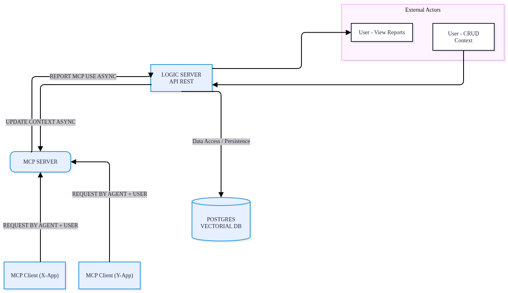

# Managing_MCP

## 1. Overview
The solution employs a multi-repository pattern. The primary repository functions as the Context Logic Manager and handles all external user API communications. The secondary repositories contain the MCP Server, which maintains an updated context by receiving asynchronous messages from the core logic service. Crucially, the MCP Servers actively report operational status and encountered issues back to the central Logic Service. This mechanism allows the system to improve its contextual awareness and deliver customized information tailored to the specific developer or agent requesting it.

## 2. Technologies
*   **Language:** Python 3.14 (as per environment).
*   **Asynchronous Communication:** [Kafka-python](https://github.com/dpereira/kafka-python) for event-driven updates.
*   **Data Validation:** [Pydantic](https://docs.pydantic.dev/) for Domain Models, DTOs, and API schemas.
*   **Dependency Management:** [UV](https://github.com/astral-sh/uv) for project and environment management.
*   **Testing:** [Testcontainers](https://testcontainers.com/) for integration testing with real Dockerized instances of Kafka.

## Location of documentation for each type of repository

Logic manage: https://github.com/AgustinRT/resources_orchester/blob/main/README.md

MCP type 1: https://github.com/AgustinRT/initial_mcp/blob/main/README.md
